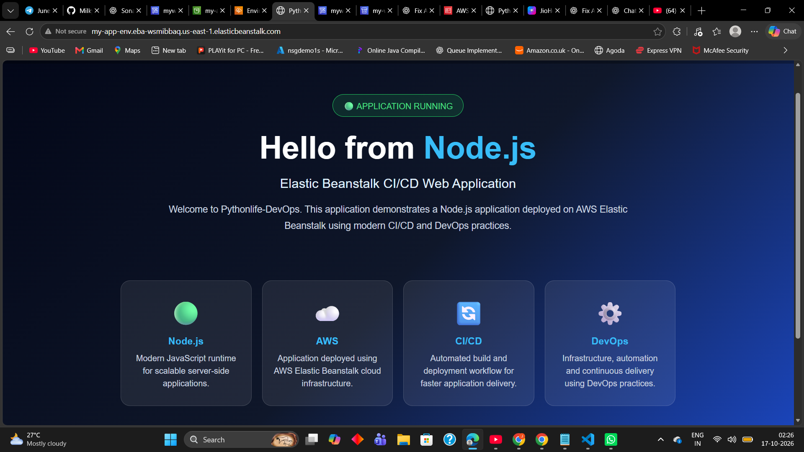

# AWS Elastic Beanstalk CI/CD Project

A Node.js web application deployed on AWS Elastic Beanstalk using a
GitHub-based CI/CD workflow with AWS CodePipeline and AWS CodeBuild.

## Live Application

[Open the deployed
application](http://my-app-env.eba-wsmjbbag.us-east-1.elasticbeanstalk.com)

> The demo currently uses HTTP. Do not submit sensitive information
> through this endpoint.

## Architecture

``` text
Developer
   |
   v
GitHub Repository
   |
   v
AWS CodePipeline
   |
   v
AWS CodeBuild
   |
   v
Build Artifact (ZIP)
   |
   v
AWS Elastic Beanstalk
   |
   v
Live Node.js Application
```

## Technology Stack

-   Node.js and Express.js
-   Git and GitHub
-   AWS CodePipeline
-   AWS CodeBuild
-   AWS Elastic Beanstalk
-   Amazon S3 for artifact storage

## Project Highlights

-   Packaged a Node.js application for deployment to Elastic Beanstalk.
-   Configured a CodeBuild buildspec to validate application files and
    produce a deployment artifact.
-   Connected the source, build, and deploy stages in CodePipeline.
-   Troubleshot IAM permissions, artifact paths, and application bundle
    structure.
-   Verified that the deployed application was accessible through its
    Elastic Beanstalk URL.

## Proof of Deployment

### Live application

The deployed page displays "APPLICATION RUNNING" and "Hello from
Node.js".



### Successful CI/CD pipeline

The CodePipeline execution shows Source, Build, and Deploy as
successful.


## Repository Structure

``` text
Elastic-Beanstalk-aws-project/
├── my-beanstalk-app/
│   ├── package.json
│   ├── package-lock.json
│   ├── server.js
│   └── buildspec.yml
├── screenshots/
│   ├── application-running.png
│   └── pipeline-success.png
└── README.md
```

Adjust the tree if your repository contains additional files or a
different layout.

## Deployment Workflow

1.  Push code changes to GitHub.
2.  CodePipeline detects the source change.
3.  CodeBuild installs dependencies, validates the app files, and
    packages the application.
4.  CodePipeline passes the build artifact to the Elastic Beanstalk
    deploy action.
5.  Verify the application using the environment URL.

## Troubleshooting Experience

During implementation, I investigated issues involving:

-   The `elasticbeanstalk:CreateApplicationVersion` IAM permission.
-   Application bundle structure and root-level `package.json` /
    `server.js` files.
-   CodeBuild artifact configuration.
-   CodePipeline stage order and deploy input artifacts.

## Potential Improvements

-   Add automated tests before deployment.
-   Provision infrastructure with Terraform.
-   Configure CloudWatch logs, alarms, and monitoring.
-   Document and test rollback procedures.
-   Configure HTTPS with a custom domain.

## Author

**Jaya Vardhan Nidizivvi**

GitHub: [Vardhan-21](https://github.com/Vardhan-21)
